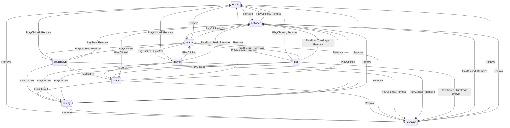

# The command graph

Everything that can be done to Mouse Party, as the fuzzers walk it. Drawn from
`graph_test.go` (`windowGraph`, `socketGraph`) and `apps/commands.go` (`apps.Commands`) by
`UPDATE_GRAPH=1 go test -run TestCommandGraphDoc .`; `go test` fails while it's stale. How it's tested: `docs/testing.md`.

## The Mac window

Its states are `App.state`'s; each command acts only in the states it leads from, and changes nothing in any other.

Besides those, the app moves on its own (the link made, a countdown over, a movie ended, a file gone).

| Command | What it is | Acts in |
|---|---|---|
| `PlayClicked` | Play, or Stop | ready, countdown, movie, doc, between |
| `PlayRow` | a row double-clicked: play it, or switch to it | ready, countdown, movie, doc, between |
| `Seek` | the slider let go | movie |
| `ShowPage` | a PDF's page, from the slider | doc |
| `TurnPage` | the arrow keys; past the last page, on | doc |
| `Select` | a row clicked | every state |
| `Move` | a row dragged | every state |
| `Remove` | Backspace: the selected row | every state |
| `LinkClicked` | copy the link, or try again for one | every state |
| `SetSettingsText` | Party > Settings: the settings and the list, as JSON (off the app's goroutine; while playing it says Stop first) | every state |
| `AddPaths` | files dropped (off the app's goroutine: no immediate state) | every state |

Not walked: `GetView`, a question, not a command: every step reads the view; `SetPasscode`, the sealed party (store_test.go); `SettingsText`, a question: SetSettingsText is walked; `StartOver`, the sealed party (store_test.go); `Unlock`, the sealed party (store_test.go): Argon2 is too slow to fuzz.

## A viewer's page, on its socket

| Type | Fields | What it is |
|---|---|---|
| `join` | `name` (str) | take a name (or another) |
| `say` | `text` (str) | a line of chat |
| `app_open` | `name` (app) | open an app for everyone |
| `app_close` | `id` (appid) | close one for everyone |
| `doc_at` | `token` (str), `at` (str), `back` (bool) | a page of the database up |
| `app` | `id` (appid) | a message for an app: its kind and fields are apps.Commands |

## The apps

What a page sends each app, as `{"type": "app", "id", "kind", ...}`.

| App | Kind | Fields |
|---|---|---|
| Graffiti | `line` | `c` (int), `w` (int), `p` (points) |
| Room | `go` | `x` (num), `y` (num) |
| Call | `join` |  |
|  | `live` |  |
|  | `leave` |  |
|  | `mute` | `muted` (bool) |
| Bingo | `card` |  |
| Word Grid | `word` | `word` (str) |
| Tiles | `play` | `tiles` (tiles) |
|  | `swap` | `letters` (str) |
|  | `pass` |  |
|  | `join` |  |
|  | `leave` |  |
|  | `start` |  |
| Anagrams | `guess` | `guess` (str) |
| Sketch | `line` | `c` (int), `w` (int), `p` (points) |
|  | `clear` |  |
|  | `guess` | `guess` (str) |
|  | `join` |  |
|  | `leave` |  |
|  | `start` |  |
| Blanks | `answer` | `text` (str) |
|  | `vote` | `i` (int) |
| Spies | `pick` | `i` (int) |
|  | `clue` | `word` (str), `n` (int) |
|  | `pass` |  |
|  | `join` |  |
|  | `leave` |  |
|  | `start` |  |
| Werewolf | `kill` | `i` (int) |
|  | `see` | `i` (int) |
|  | `exile` | `i` (int) |
|  | `join` |  |
|  | `leave` |  |
|  | `start` |  |
| Polls | `ask` | `question` (str), `options` (strs) |
|  | `vote` | `i` (int) |
|  | `close` |  |
| Document | `edit` | `base` (int), `eid` (str), `ops` (ops) |
|  | `snap` | `seq` (int), `text` (str) |
|  | `seed` | `text` (str) |
|  | `sync` |  |
| Outline | `edit` | `base` (int), `eid` (str), `ops` (ops) |
|  | `snap` | `seq` (int), `text` (str) |
|  | `seed` | `text` (str) |
|  | `sync` |  |
| Slides | `edit` | `base` (int), `eid` (str), `ops` (ops) |
|  | `snap` | `seq` (int), `text` (str) |
|  | `seed` | `text` (str) |
|  | `sync` |  |
| Sheet | `edit` | `base` (int), `eid` (str), `ops` (ops) |
|  | `snap` | `seq` (int), `text` (str) |
|  | `seed` | `text` (str) |
|  | `sync` |  |
| Diagram | `edit` | `base` (int), `eid` (str), `ops` (ops) |
|  | `snap` | `seq` (int), `text` (str) |
|  | `seed` | `text` (str) |
|  | `sync` |  |
| Drawing | `edit` | `base` (int), `eid` (str), `ops` (ops) |
|  | `snap` | `seq` (int), `text` (str) |
|  | `seed` | `text` (str) |
|  | `sync` |  |
| Pinboard | `edit` | `base` (int), `eid` (str), `ops` (ops) |
|  | `snap` | `seq` (int), `text` (str) |
|  | `seed` | `text` (str) |
|  | `sync` |  |
| Graffiti Reel | (none) | |
